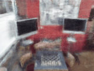

# PoseNeRF

PoseNeRF is a reproducible research implementation of hierarchical neural radiance fields for RGB/depth reconstruction on Microsoft 7-Scenes Chess. It includes checkpoint-safe training, frozen train-derived validation, rendering, and experimental RGB-only localization components.



The GIF is a real 160×120 render from the immutable E8-D2 terminal continuation checkpoint, using an interpolated path through frozen train-derived validation C2W poses. It is **not** a synthetic demonstration. [MP4 playback](docs/media/posenerf_demo.mp4) · [RGB/depth comparison](docs/media/posenerf_comparison.png) · [media provenance](docs/media/posenerf_demo_provenance.json).

## Verified reconstruction benchmark

Frozen 12-view, train-derived Chess validation; 48 coarse + 48 fine samples; same masks and preprocessing for every value. These are validation metrics, not held-out test or localization claims.

| Checkpoint | PSNR ↑ | Global SSIM ↑ | Depth MAE ↓ | RMSE ↓ | AbsRel ↓ | Mean / P95 render latency | Peak CUDA memory |
|---|---:|---:|---:|---:|---:|---:|---:|
| E8-D2 terminal continuation (500 updates, depth weight 0.15) | 18.8159 dB | 0.8150 | 0.13685 m | 0.19939 m | 0.07402 | 3434.4 / 3656.8 ms | 456.6 MiB |

The evaluated model is 10 layers × 512 hidden units, **5,662,216 parameters**. Its terminal export SHA-256 is `30dc02247990daa3fb0bd67ccb054051b5dcf4dfafc4aec7638b5ada0fd26710`. Full per-view evidence remains outside Git in the immutable evaluation artifacts.

## Reproduce the render

```powershell
.\.venv\Scripts\python.exe scripts\render_reconstruction_video.py `
  --run workspace\outputs\m14_e8_d2_lrfix_500 --frames 4 --fps 3 --output docs\media
```

The renderer uses the existing `HierarchicalNeRF`, `get_ray_directions`, and `render_image` implementation; no parallel NeRF model or camera pipeline is introduced. The recorded camera convention is OpenCV C2W, and the path is translation interpolation plus SO(3)-projected rotation interpolation.

## Architecture

- Hierarchical coarse/fine radiance fields with positional encoding and volumetric rendering.
- 10-layer, width-512 E8 fields; 48+48 samples at the frozen evaluation setting.
- AMP-aware gradient accumulation, atomic full-state checkpoints, scheduler/RNG/sampler restoration, and independent thermal watchdog support.

## Installation and tests

```powershell
python -m venv .venv
.\.venv\Scripts\Activate.ps1
python -m pip install -r requirements.txt
python -m pytest -q
```

## Notebook and containers

`PoseNeRF_End_to_End.ipynb` is the existing project walkthrough. It uses project modules and is therefore not a portable standalone notebook. A fully standalone rendering notebook remains a follow-up item; it must only accept explicitly compatible checkpoints and must not alter them.

Container assets are not yet included in this repository. Use the native environment above; do not treat the secondary `NeRF-Video-Studio` project’s Docker files as PoseNeRF deployment support.

## Attribution and limitations

The implementation is independently written and informed by [bmild/nerf](https://github.com/bmild/nerf) and the NeRF paper. It does not bundle that repository’s data, checkpoints, or code.

Results are limited to the documented Chess protocols and hardware. Validation reconstruction does not establish held-out localization accuracy, real-time performance, deployment performance, or generalization to other scenes. Existing checkpoints, frozen protocols, and historical artifacts are preserved and excluded from version control.
